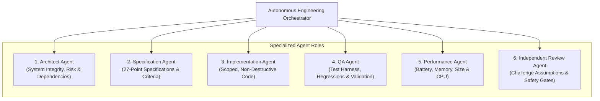

# TruePace — Autonomous Agent Architecture

## 1. Multi-Role Engineering System

To support autonomous, high-quality product evolution, the engineering orchestrator operates through specialized logical roles:

---

## 2. Role Responsibilities & Handshake Protocol

1. **Architect Agent**: Evaluates proposed features against non-negotiable principles (tracking determinism, battery-first, minimal dependencies). Defines architectural blueprints and data models.
2. **Specification Agent**: Translates features into the standard 27-section specification format with precise, testable acceptance criteria.
3. **Implementation Agent**: Executes code changes in small, isolated increments. Respects existing conventions, preserves documentation, and introduces zero unrelated refactorings.
4. **QA Agent**: Formulates test suites, verifies mathematical formulas, audits edge cases, and guarantees no functional regressions occur.
5. **Performance Agent**: Profiles CPU, memory, battery, and APK size impact, ensuring performance budgets are strictly maintained.
6. **Independent Review Agent**: Conducts adversarial reviews of code and specifications, questioning assumptions, verifying security/privacy compliance, and serving as the final gatekeeper before marking any task COMPLETE.
