# TruePace — AI-Native Architecture Specification

## 1. Principles of AI Integration in TruePace

TruePace adopts a **Hybrid Intelligence Architecture**:

1. **Inviolable Separation**: AI is strictly decoupled from the real-time tracking engine. Mathematical truth (distance, pace, splits, active duration) is 100% deterministic and calculated on-device in pure TypeScript.
2. **Battery & Resource Zero-Impact**: AI never executes in the background or during an active run. All AI operations are on-demand or post-workout.
3. **Graceful Degradation**: The entire application works completely offline. If AI services are unavailable, offline, or disabled, 100% of core tracking, splits, and history functionality remains active.
4. **Structured & Verifiable**: AI outputs must conform to strict JSON schemas with clear metrics references, preventing hallucinations.

---

## 2. Partitioned Intelligence Model

```mermaid
flowchart LR
    subgraph Deterministic_Engine ["Deterministic Intelligence (On-Device)"]
        D1["Distance (Haversine)"]
        D2["Instantaneous Pace (Doppler)"]
        D3["Split Timers & Milestones"]
        D4["Pace Consistency Index (StdDev)"]
        D5["Personal Records (1K, 5K, 10K)"]
        D6["Acute:Chronic Workload Ratio"]
    end

    subgraph Aggregated_Payload ["Sanitized Aggregated Summary"]
        P1["Total Distance & Duration"]
        P2["Per-KM Split Array"]
        P3["Pace Variance & Degradation"]
        P4["No Raw Lat/Lon GPS Coordinates"]
    end

    subgraph AI_Intelligence ["AI Coaching Intelligence (Post-Run Only)"]
        A1["Narrative Workout Breakdown"]
        A2["Fatigue Onset Explanation"]
        A3["Recovery Time Recommendations"]
        A4["Adaptive Mileage Guidance"]
    end

    Deterministic_Engine --> Aggregated_Payload
    Aggregated_Payload --> AI_Intelligence
```



---

## 3. Post-Run AI Insight Schema

When triggered, the AI coach produces a validated structured response:

```typescript
interface AiRunCoachingReport {
  summaryTitle: string;             // e.g. "Strong negative split with late surge"
  performanceCategory: 'recovery' | 'base_building' | 'tempo' | 'threshold' | 'interval';
  pacingEvaluation: {
    consistencyGrade: 'A' | 'B' | 'C' | 'D';
    pacingStrategy: 'even' | 'negative_split' | 'positive_split' | 'erratic';
    fatigueOnsetKilometer: number | null; // KM where split time increased by >10%
    observation: string;
  };
  recoveryAdvice: {
    recommendedRestHours: number;
    recommendedNextWorkout: string;
    hydrationNutritionTip: string;
  };
  trainingPlanAdjustment: string | null;
}
```

---

## 4. Key Management & Privacy Shield

- **Zero Coordinate Exfiltration**: Raw latitude and longitude coordinates are NEVER sent to external LLMs. Only aggregated statistics (e.g. `splits: [312, 308, 305, 310]`, `totalKm: 4.0`) are supplied.
- **Credential Storage**: No hardcoded production API keys in client builds. Uses an optional serverless edge proxy (Cloudflare Worker / Firebase Function) or user-supplied BYOK (Bring Your Own Key) saved securely in device keystore/secure storage.
