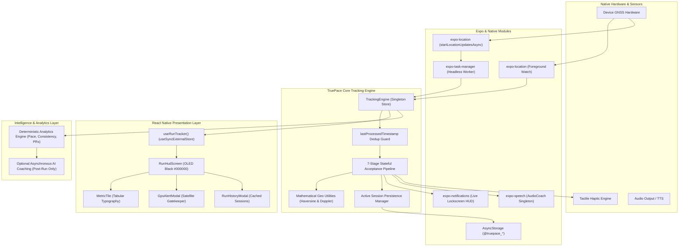

# TruePace — System Architecture

## 1. High-Level Architecture Diagram

---

## 2. Layer Responsibilities

### 2.1 Hardware & Native Sensor Layer
- Captures raw NMEA / GNSS satellite positions and speeds.
- Emits foreground coordinate streams while app is focused.
- Triggers background headless task via `expo-task-manager` and Android foreground service when app is backgrounded or screen is locked.

### 2.2 Core Tracking Engine Layer
- **Singleton Authority**: `TrackingEngine` holds the single source of truth for distance, active duration, status, speed, and splits.
- **Deduplication Guard**: Compares incoming coordinate timestamps against `lastProcessedTimestamp` to guarantee points from concurrent streams are processed exactly once.
- **Stateful Acceptance Pipeline**: Sequentially validates coordinates, filters stationary drift, enforces distance movement thresholds, and detects km milestones.
- **Active Elapsed Time**: Measures wall-clock time minus total paused milliseconds.

### 2.3 Presentation Layer
- **Zero Live Map**: Strictly minimal OLED dark UI built with NativeWind.
- **Tabular Synchronization**: Uses React's `useSyncExternalStore` to subscribe directly to `TrackingEngine`, achieving tear-free 60fps telemetry updates without unnecessary React re-renders.
- **GPS Gatekeeper**: Hardware status lock prevents starting a run with inadequate accuracy or missing permissions.

### 2.4 Intelligence Layer
- **Deterministic First**: Computes running metrics, split variances, personal records, and pacing trends locally in pure TypeScript.
- **AI Optional**: Dispatches post-run aggregated workout summaries to an optional, asynchronous AI coaching agent without ever blocking active tracking.
