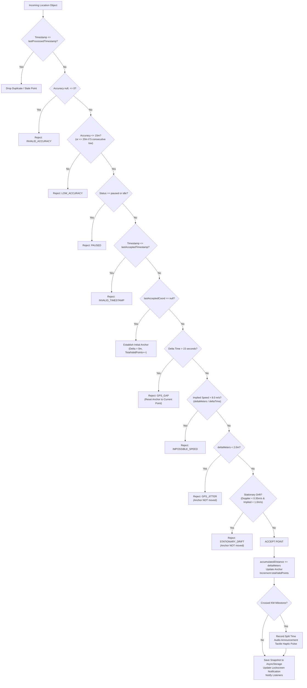

# TruePace — Tracking Engine Specification

## 1. Engine Core State & Separation of Concerns

The `TrackingEngine` singleton maintains a strict separation between raw GNSS observations and accepted distance anchors:

- **Raw Observation**: `lastGpsReading` holds the most recent coordinate reported by `expo-location`, regardless of validity.
- **Accepted Anchor**: `lastAcceptedCoord` and `lastAcceptedTimestamp` represent the latest point that successfully passed all verification gates and contributed to `accumulatedDistance`.
- **Inviolable Anchor Rule**: Rejected points **NEVER** move the anchor.

---

## 2. Stateful Acceptance Pipeline Flow

---

## 3. Mathematical Foundations

### 3.1 Earth Curvature Distance (Haversine Formula)
Given two coordinate pairs $(\phi_1, \lambda_1)$ and $(\phi_2, \lambda_2)$ in radians:
$$\Delta\phi = \phi_2 - \phi_1,\quad \Delta\lambda = \lambda_2 - \lambda_1$$
$$a = \sin^2\left(\frac{\Delta\phi}{2}\right) + \cos(\phi_1)\cos(\phi_2)\sin^2\left(\frac{\Delta\lambda}{2}\right)$$
$$c = 2\cdot \operatorname{atan2}\left(\sqrt{a},\, \sqrt{1-a}\right)$$
$$d = R\cdot c\quad (R = 6,371,000\text{ m})$$

### 3.2 Instantaneous Pace
Computed from native hardware Doppler speed $v$ in $\text{m/s}$:
$$\text{Pace}_{\text{instant}} = \frac{1000}{v}\quad (\text{seconds per kilometer})$$
Filtered for running plausibility: valid when $v \ge 0.5\text{ m/s}$ ($\approx 1.8\text{ km/h}$) and $90\text{s} \le \text{Pace} \le 1200\text{s}$. If Doppler is unavailable, rolling average across the last 10 seconds is used. Stationary state displays `--'--"`.

### 3.3 Active Moving Time
Wall-clock elapsed time strictly excludes pauses:
$$t_{\text{active}} = \left\lfloor\frac{T_{\text{now}} - T_{\text{start}} - T_{\text{totalPaused}}}{1000}\right\rfloor\quad (\text{seconds})$$
$$\text{Average Pace} = \frac{t_{\text{active}}}{d_{\text{km}}}\quad (\text{seconds per kilometer})$$
