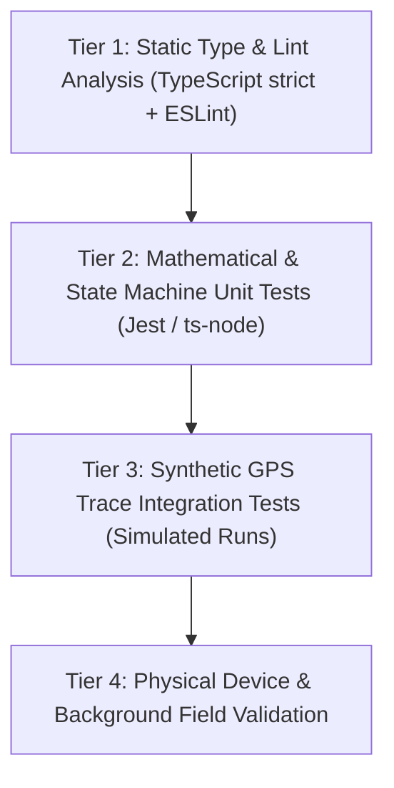

# TruePace — Quality & Test Strategy

## 1. Testing Philosophy

TruePace is a precision sports telemetry tool. Flawed math or state machine regressions compromise athlete training and destroy user trust. 

Our test strategy is structured around four testing tiers:

---

## 2. Test Tiers & Execution

### 2.1 Tier 1: Static Analysis
- **TypeScript**: `npx tsc --noEmit` must pass with zero errors in strict mode.
- **ESLint**: `npx expo lint` must pass with zero warnings and zero errors.
- **Expo Doctor**: `npx expo-doctor` must pass all core checks.

### 2.2 Tier 2: Mathematical & Algorithmic Unit Tests
- Pure unit tests verifying:
  - `calculateHaversineDistance()` across known global coordinate baselines.
  - `speedToPace()` and `calculateAveragePace()` edge cases (0 m/s, negative, sprint bounds, walk bounds).
  - 7-stage coordinate acceptance logic in `TrackingEngine.processLocation()`.
  - Pause / resume anchor clearing and deduplication.
  - Per-km split boundary triggering and multi-km jump handling.

### 2.3 Tier 3: Synthetic Trace Integration Tests
- Replays recorded real-world GPX/JSON coordinate streams:
  - **Stationary Drift Trace**: 20 minutes of indoor phone jitter (must accumulate exactly 0 meters).
  - **Track Workout Trace**: 400m intervals with stops (verifies active time and pause exclusion).
  - **Tunnel / Signal Loss Trace**: 30-second GPS blackout (verifies gap reset without straight-line teleportation).
  - **Cold Restart Recovery Trace**: Process eviction during tracking (verifies session snapshot restoration).

### 2.4 Tier 4: Physical Device Field Validation
- Physical Android and iOS devices tested under real outdoor conditions.
- Validates screen-lock background handoff, Android foreground notification delivery, and audio coach volume over Bluetooth headphones.

---

## 3. Automation Implementation Plan (Phase 1 Prerequisite)
Currently, the repository has 0 automated tests. In Phase 1, we will configure a lightweight test runner (Jest with `ts-jest` or native Node test runner) targeting `src/utils/` and `src/services/TrackingEngine.ts` to build our automated regression firewall.
